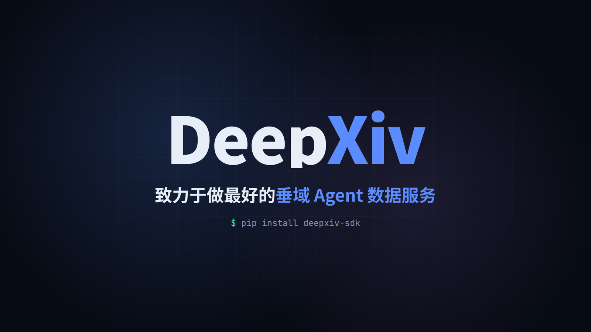

<h1 align="center">DeepXiv</h1>
<p align="center"><em>The data layer agentic search is missing — full paper text, real citations, and the people behind them.</em></p>

<p align="center">
  <a href="https://1stauthor.com/assistant/">Live system</a> ·
  <a href="USAGE.md">Full documentation</a> ·
  <a href="https://data.rag.ac.cn/api/docs">API docs</a> ·
  <a href="https://data.rag.ac.cn/status">Status</a> ·
  <a href="https://arxiv.org/abs/2603.00084"></a> ·
  <a href="README.zh.md">中文</a>
</p>

<p align="center">
  
</p>

> [!IMPORTANT]
> **Capacity: about 50 requests per second, shared by everyone.** DeepXiv's paper service and the 1stAuthor services run on small servers with limited compute and bandwidth. Donations to keep it running are very welcome 🙏. If you need large volumes, email `tommy[at]chien.io` and we'll work out a plan together.

---

## What it is

A CLI and Python SDK over a service that has already read the literature. Papers arrive parsed into sections rather than PDFs, retrieval runs over full bodies rather than abstracts, and an agentic endpoint answers questions with citations that resolve to real arXiv IDs and URLs.

Four things it does:

| | Command | |
|---|---|---|
| **Ask the literature** | `deepxiv ask` | A question in, an answer out, cited with real arXiv IDs |
| **Ask the web** | `deepxiv ask --web` | Same, over Google plus cached page bodies |
| **Read a paper in layers** | `deepxiv search` / `paper` | Search, judge, then read only the section you need |
| **Find the people** | `deepxiv fa … talent` | Who works on a topic, where, and what their record is |
| **Watch US stocks** 🆕 | `deepxiv fa … stocks` | 8,000+ tickers: prices, per-ticker news, filings, financials, macro — point-in-time, and `fa ask -d stocks` for a cited analysis |
| **Go beyond papers** | `deepxiv fa` | Statutes, judgments, trials, drugs, grants, filings, standards, CVEs — via 1stAuthor |

## What problem it solves

An agent researching a topic has bad options. Search APIs return ten blue links and abstracts — enough to name a paper, never enough to answer "what speedup does it report on HumanEval". PDFs answer that, but cost 50k tokens each and arrive as a wall of text with no structure to navigate.

DeepXiv removes the tradeoff. Papers are pre-parsed, so an agent can spend 300 tokens on a TLDR to decide whether to spend 5k on the Methods section. Questions that need evidence go to the agentic endpoint, which reads source text and hands back an answer with citations you can check. And because knowing *who* does the work is half of research, the same token searches scholars — plus law, clinical trials, drugs, grants and more through [1stAuthor](https://1stauthor.com)'s domains.

## DeepXiv × 1stAuthor

DeepXiv works closely with [1stAuthor](https://1stauthor.com) to serve data beyond papers: researchers, US stocks, statutes, court judgments, clinical trials, drugs, grants, filings, standards and CVEs, all reached through `deepxiv fa` with the same token. **→ [The `deepxiv fa` guide](FA.md)**

One CLI, fifteen domains, the same three verbs: `search` → `read` → `ask`.

| Domain | What's in it |
|---|---|
| **`stocks`** 🆕 | **8,000+ US tickers: prices, per-ticker news and events, SEC filings, financials, macro series and news — all point-in-time** |
| `talent` | AI researcher profiles: education, career, top papers, metrics |
| `appraise` | What academicians and fellows said when they cited a paper |
| `law` · `us_law` · `uk_eu_law` · `fr` | Chinese and 25 other jurisdictions' statutes; US statutes and regulations; UK and EU legislation; Federal Register |
| `cases` | Chinese and US court judgments |
| `trials` · `drugs` · `grants` | ClinicalTrials.gov, openFDA drug labels, NSF / NIH grants |
| `filings` · `standards` | SEC and Chinese company filings, Chinese national standards |
| `cve` · `osv` | NVD + CISA KEV + EPSS; open-source package advisories and malicious-package reports |

> **Pass `--domain` (`-d`).** Auto-routing (`fa ask` without `-d`) is still in early development and can pick the wrong domain. Name the domain yourself; `deepxiv fa domains` lists them and `deepxiv fa spec DOMAIN` shows its filters.

```bash
# People: China-based students working on world models
deepxiv fa search talent "world model" -F career_stage=student -F location=北京,上海 -k 20

# Which academicians / fellows cited DeepSeek-R1, and what the positive ones said
deepxiv fa read appraise arxiv:2501.12948 -l brief
deepxiv fa read appraise arxiv:2501.12948 -p stance=positive -p org=CAS,CAE

# Law and cases: statutes plus US Supreme Court judgments
deepxiv fa search law "个人信息保护" -k 5
deepxiv fa search cases "qualified immunity police" -F country=us -F court_level=scotus -k 5

# Trials, filings, vulnerabilities
deepxiv fa search trials "GLP-1 obesity" -F phase=PHASE3 -F overall_status=RECRUITING -k 5
deepxiv fa search filings "CEO resignation" -F market=us -F "filed_year>=2023" -k 5
deepxiv fa search cve "*" -F kev=true -F severity=critical,high --sort epss -k 10

# A cited answer over one domain (agentic quota; SDK token: 3 trial asks)
deepxiv fa ask "个人信息出境需要满足什么条件" -d law
deepxiv fa ask "DeepSeek-R1 得到了哪些院士的正面评价" -d appraise -p paper=arxiv:2501.12948
```

### 🆕 US stocks

`deepxiv fa … stocks` gives an agent point-in-time US equity data: **8,000+ tickers** with daily prices, **per-ticker news** (3.9M stories since April 2026, deduplicated and clustered into ~920k events with a tone label), SEC filings, XBRL financials, and **macro series and news** (CPI, industrial production, Treasury yields, FX, commodities, with consensus/nowcast comparisons). Every query takes `as_of`, which returns only what was visible at that moment — so backtests and "what did we know on day X" questions don't leak the future.

```bash
deepxiv fa read stocks NVDA                                      # price vs sector & SPY, recent events, news, filings
deepxiv fa read stocks NVDA -e news                              # the ticker's news feed
deepxiv fa read stocks NVDA -e financials                        # XBRL financials, as filed
deepxiv fa read stocks NVDA -p as_of=2026-09-04                  # the same view as of a past day (here: the Hugging Face deal 8-K)
deepxiv fa search stocks "AI data center power" -F source=stocks # which tickers a theme touches
deepxiv fa search stocks "chip export restrictions" -k 5         # news + events + filings, ranked together
deepxiv fa search stocks "earnings guidance" -F ticker=TSLA -F source=events
deepxiv fa read stocks digest:macro                              # today's macro releases, rates, FX, commodities
deepxiv fa read stocks macro:CPIAUCSL                            # a macro series with vintages and nowcast

# Or just ask: the agent pulls prices, news, events, filings, financials and macro, and cites every record
deepxiv fa ask "CoreWeave 最近一周为什么大跌？结合价格、新闻和财报说明" -d stocks
```

**`fa ask -d stocks` is live**: ask about a theme, a ticker's moves, events, insider trades, financials or macro, and get an answer that cites upstream record ids (`[stocks:px:CRWV:2026-10-16]`, `[stocks:news:…]`, `[stocks:fin:…]`). Questions about a past moment are answered as of that moment. Answers end with the data sources and a not-investment-advice note. `deepxiv fa spec stocks` lists sources, filters and extras.

DeepXiv itself stays focused on agentic data services for academic papers, and **will remain free**. If you need higher limits on the 1stAuthor domains, see [1stauthor.com](https://1stauthor.com).

> 1stAuthor is in closed beta. Questions or problems? [Open an issue](https://github.com/DeepXiv/deepxiv_sdk/issues).

## Install

```bash
pip install deepxiv-sdk
```

`deepxiv fa` (1stAuthor domains, including talent) needs 1.2.0 or later: `pip install -U deepxiv-sdk`.

`deepxiv` auto-registers a token on first use. Agentic commands (`ask`, `fa ask`) need a registered key; the auto-registered token gets 3 lifetime trial `fa ask` calls. Get a key at [data.rag.ac.cn/register](https://data.rag.ac.cn/register), then:

```bash
deepxiv config --token YOUR_REGISTERED_KEY
```

During the beta, a registered key uses the 1stAuthor domains on the same terms as 1stAuthor's own users:

- **`deepxiv fa ask`** draws on a **daily ask allowance** that resets at 00:00 UTC. When it runs out, you'll see "今日 AI 问答额度已用完" (today's ask allowance is used up). There is also a site-wide daily total, which can run out early at peak times.
- **`deepxiv fa search` / `read`** are fair use, rate-limited to 60 requests a minute, 5 at once and 5,000 a day.
- **`talent`** also has a daily read limit on profile content (search and cards aren't capped).
- **The auto-registered token** stays as it is: 3 lifetime trial `fa ask` calls, then a prompt to register at [data.rag.ac.cn/register](https://data.rag.ac.cn/register).
- **On a 429**, back off for the number of seconds in `Retry-After`.

`deepxiv ask` (papers) is DeepXiv's own and unchanged: 300 calls/day on a registered key, on a pool separate from the general daily limit.

## Usage

One investigation, start to finish. You've heard speculative decoding got much faster this year and want to know what's real.

**1. Ask the literature.** Start with the question, not a keyword. The service picks its own tools, reads paper bodies, and cites what it used.

```bash
deepxiv ask "what speedup does speculative decoding report on HumanEval in 2025"
```

```
DEER reports a 5.54× speedup on HumanEval (with Qwen3-30B-A3B as the target
model), compared to EAGLE-3's 2.41× on the same benchmark [arXiv:2512.15176].

📚 Sources (1 cited, 10 retrieved — use --all-sources for the rest):
  1. [2512.15176] DEER: Draft with Diffusion, Verify with Autoregressive Models
```

<p align="center">
  
  <br>
  <em><code>deepxiv ask</code> — a question in, a cited answer streaming out</em>
</p>

The answer goes to stdout and sources to stderr, so `deepxiv ask "…" > answer.md` captures just the answer. Add `--effort high` when a question spans several papers.

**2. Read the paper it cited — in layers.** Never load a whole paper to answer a question about one section.

```bash
deepxiv paper 2512.15176 --brief              # title, TLDR, keywords, citations — worth reading?
deepxiv paper 2512.15176 --head               # section list + where the tokens are
deepxiv paper 2512.15176 --section Experiment # read only that
```

Each step costs an order of magnitude more than the last, so you stop as soon as you have your answer. Take section names from `--head` — papers don't share a common outline. `--preview` gives ~10k chars; no flag at all gives the full markdown.

**3. Widen it into a search.** Once you know what you're looking for, filter for the rest.

```bash
deepxiv search "speculative decoding" --date-from 2025-01 --min-citations 20 --limit 10
```

Filters combine with `AND` — `--authors`, `--orgs`, `--categories`, `--venue`/`--venue-year`, dates, citation floors. Stack too many and you'll legitimately get zero results; loosen one.

**4. Find the people behind it.** A method is worth more when you know whose lab it comes from and what else they've built.

```bash
deepxiv fa search talent "speculative decoding" --top-k 5    # by topic
deepxiv fa search talent "Geoffrey Hinton"                    # or by name
deepxiv fa search talent "deep learning" -F "org=University of Toronto" -F "h_index>=50"
deepxiv fa read talent 15023                                  # profile: bio, education, career, top papers, metrics
deepxiv fa read talent 15023 --level full                     # the full researched profile (markdown)
```

Names (Chinese, pinyin, English) and topics both work. IDs from `search` feed `read`; `deepxiv fa spec talent` lists the filters and what each read level costs. `deepxiv talent search|survey` still work as deprecated aliases, but IDs from the old index don't carry over.

The same verbs cover 1stAuthor's other domains (`deepxiv fa domains` lists them). **Full guide: [FA.md](FA.md).**

```bash
deepxiv fa search law "个人信息保护" --top-k 5
deepxiv fa ask "个人信息出境需要满足什么条件" --domain law   # agentic quota; SDK token: 3 trial asks
```

**5. Step off arXiv when the question isn't academic.** Licensing, pricing, who shipped what last week — same command, different backend.

```bash
deepxiv ask "which inference providers support speculative decoding today" --web
deepxiv ask "NeurIPS 2025 best paper" --web --search-type news
```

The web backend reads *cached* page bodies. Pages read in full are marked 📄, snippet-only ones 🔗 — weigh them accordingly.

**In Python**, the same pipeline is `Reader`:

```python
from deepxiv_sdk import Reader

reader = Reader(token="YOUR_REGISTERED_KEY")   # Reader takes the token explicitly
answer = reader.agent_search("what speedup does DEER report on HumanEval")["answer"]
method = reader.section("2512.15176", "Method")
people = reader.fa().search("talent", "speculative decoding", top_k=5)
```

## Documentation

- **[USAGE.md](USAGE.md)** — full CLI reference, the Python API, streaming, error handling, batching, and the built-in research agent. ([中文](USAGE.zh.md))
- **[FA.md](FA.md)**: `deepxiv fa`, the 1stAuthor domains (talent, law, cases, trials, drugs, grants, filings, standards, CVEs, …): commands, filters, prices, errors, Python. ([中文](FA.zh.md))
- **[skills/deepxiv-cli/SKILL.md](skills/deepxiv-cli/SKILL.md)** — drop-in operating instructions for coding agents. Two worked workflows also ship as skills: [trending digest](skills/deepxiv-trending-digest/SKILL.md), [baseline table](skills/deepxiv-baseline-table/SKILL.md).
- **`skills/deepxiv-fa-*`** — one skill per 1stAuthor domain (e.g. [stocks](skills/deepxiv-fa-stocks/SKILL.md), [talent](skills/deepxiv-fa-talent/SKILL.md), [law](skills/deepxiv-fa-law/SKILL.md)): filters, read levels, extras and verified recipes as `deepxiv fa` commands, generated from the live spec by `scripts/gen_fa_skills.py`. Index: [fa-domains.md](skills/deepxiv-cli/references/fa-domains.md).
- **[examples/](examples/)** — runnable scripts for each entry point.

Also available: PubMed Central, bioRxiv/medRxiv, trending papers, and per-paper social metrics — see [USAGE.md](USAGE.md#other-sources).

## Citation

If DeepXiv is useful in your work, please cite the technical report:

```bibtex
@article{qian2026deepxiv,
  title   = {DeepXiv-SDK: An Agentic Data Interface for Scientific Literature},
  author  = {Qian, Hongjin and Xia, Ziyi and Liu, Ze and Chen, Jianlyu and
             Luo, Kun and Qin, Minghao and Li, Chaofan and Xiong, Lei and
             Lan, Junwei and Wang, Sen and Liang, Zhengyang and Shao, Yingxia and
             Lian, Defu and Liu, Zheng},
  journal = {arXiv preprint arXiv:2603.00084},
  year    = {2026},
  url     = {https://arxiv.org/abs/2603.00084}
}
```

## License & support

MIT — see [LICENSE](LICENSE).

- 🐛 **Issues**: [github.com/DeepXiv/deepxiv_sdk/issues](https://github.com/DeepXiv/deepxiv_sdk/issues)
- 📧 **Higher limits, bulk use or donations**: email `tommy[at]chien.io` with your use case
